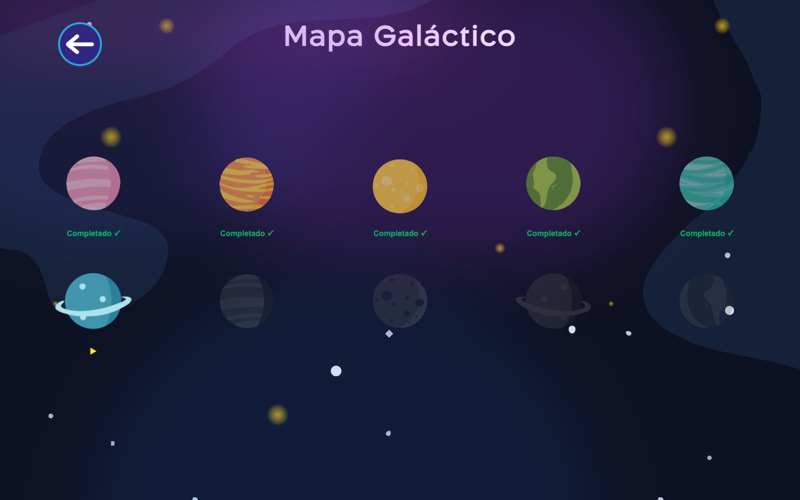
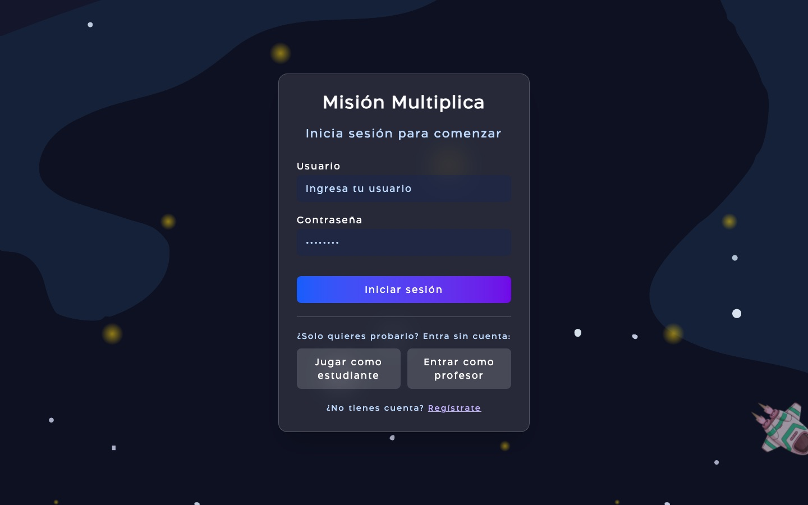
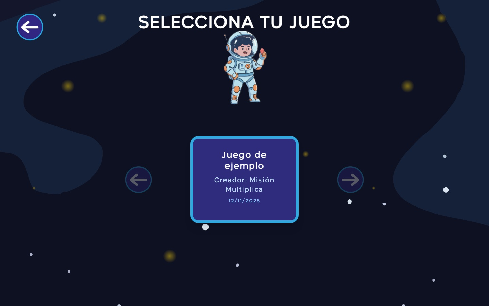
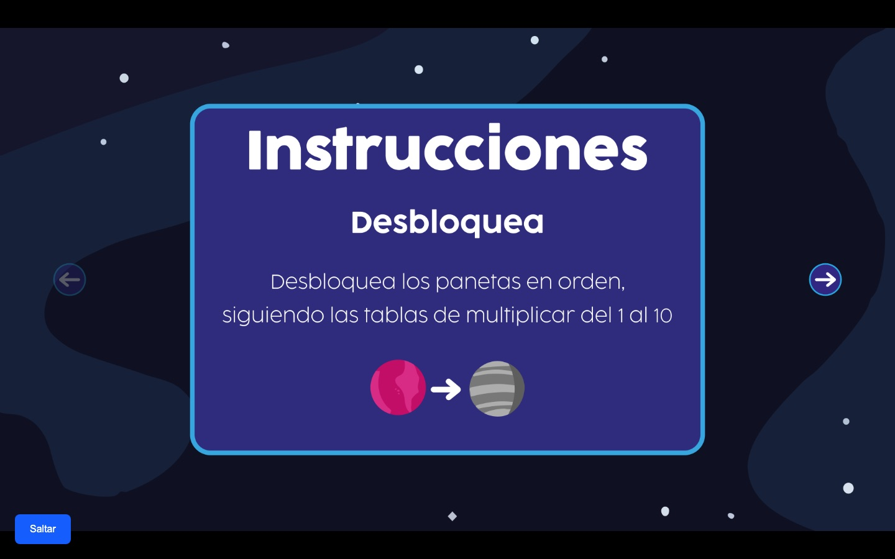
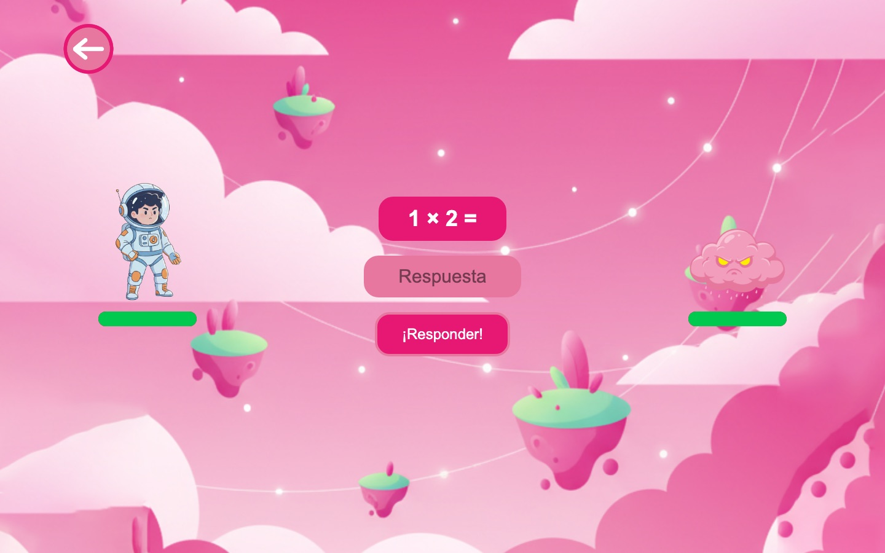
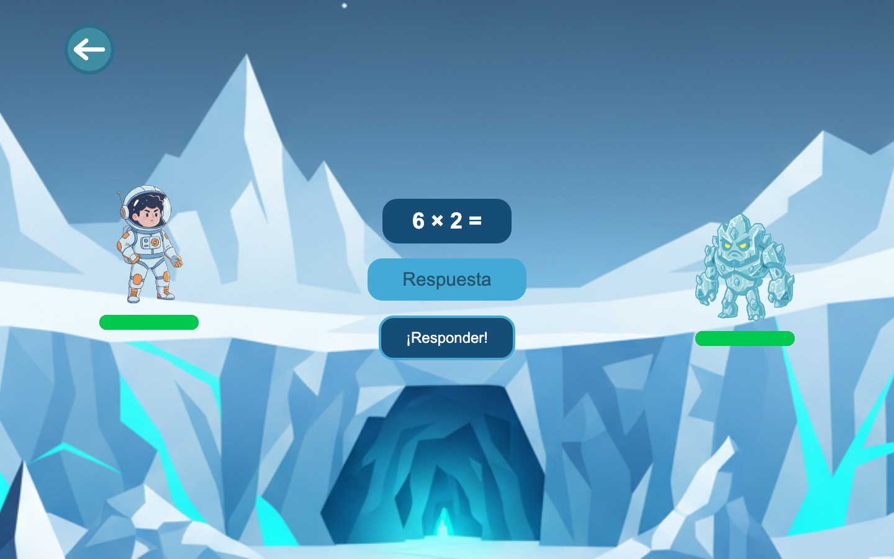

# Misión Multiplica

A serious game that helps children practice the multiplication tables: Tomi, a young astronaut, travels across 11 planets and beats each planet's boss by answering multiplication questions.

*Juego serio para que niños y niñas practiquen las tablas de multiplicar. Interfaz en español.*

**▶ Play it:** https://julian7204.github.io/juegosserios/ (choose **Jugar como estudiante** or **Entrar como profesor**; no account needed)



## How it works

- **Students** pick a game, watch the intro, read the illustrated instructions and unlock the planets in order. Planets 1 to 10 each practice one table, and planet 11 is a final boss with mixed questions.
- **Battles:** a correct answer fires at the boss; a wrong answer costs Tomi energy. Both health bars, the energy-ball animations and the sound effects react to every answer.
- **Feedback:** after each world the student reviews which answers were correct or wrong before moving on.
- **Teachers** generate a custom game: the app proposes 10 questions per world (12 in the final world), the teacher can regenerate them, and then names and saves the game for students to choose.

| Login | Game selection | Instructions |
|---|---|---|
|  |  |  |

| World 1: Rosaluna | World 6 |
|---|---|
|  |  |

## Tech stack

React 19 · TypeScript · Vite · Tailwind CSS 4 · React Router 7 · bcryptjs. Deployed on GitHub Pages with GitHub Actions.

## Run it locally

```bash
npm install
npm run dev
```

## Project history

- **2025: original game.** Built as a university project on software accessibility at Universidad del Azuay (Cuenca, Ecuador), together with a team of designers. **The game's code was written by hand, without AI assistance.** It originally used Firebase (Firestore) for accounts and saved games.
- **2026: maintenance with [Claude Code](https://claude.com/claude-code).** The Firebase project had stopped accepting requests, so the game was moved to a demo mode that needs no server:
  - accounts and teacher-made games are stored only in the player's browser (`localStorage`), so no children's data leaves the device;
  - added guest buttons and a built-in sample game;
  - fixed asset paths, music and custom cursors so the production build works on GitHub Pages;
  - removed IDE template files and fonts whose trial license did not allow redistribution.

## Credits

- **Programming:** Julian Coronel ([@julian7204](https://github.com/julian7204))
- **Collaborator:** [@rronrri](https://github.com/rronrri)

## Acknowledgments

Thanks to the design team at Universidad del Azuay, who created the art, characters, storyboard, UI and intro video of Misión Multiplica (the intro clip carries the watermark of the AI video tool Kling). The art and illustrations belong to their authors and are used here with their permission. They are not covered by any open-source license.
